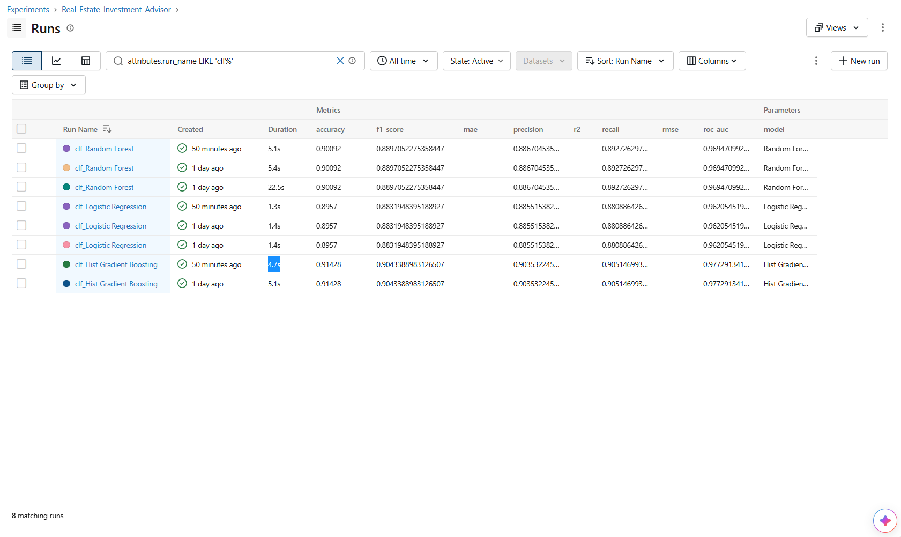
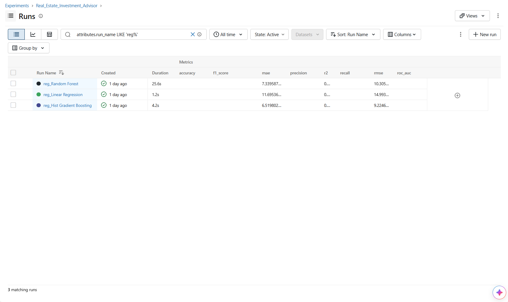
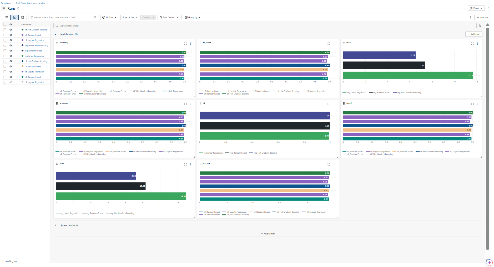
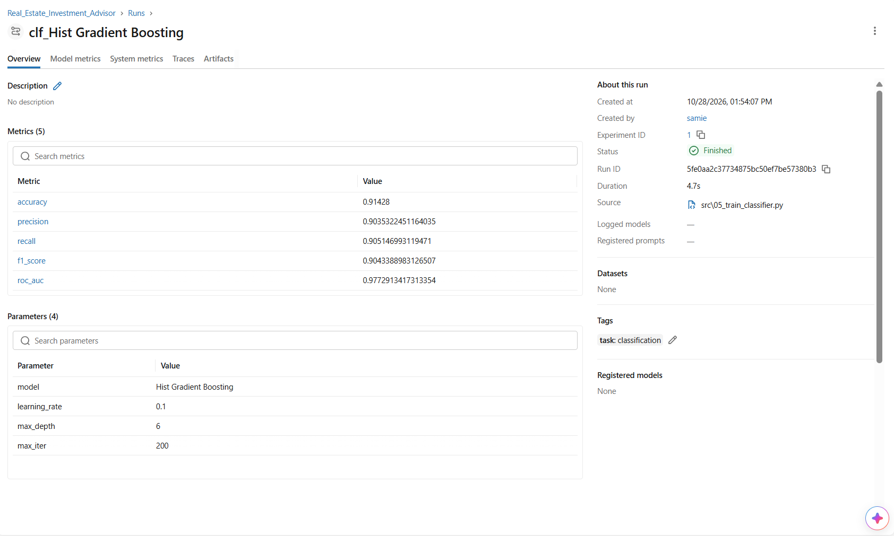

# EstateIQ: Real Estate Investment Advisor

**Live demo:** https://estateiq-advisor.streamlit.app/

Predicts whether an Indian residential property is a good investment and estimates its price after 5 years.
Built with Python, scikit-learn, XGBoost, Streamlit, Plotly and MLflow.

## Features
- **Investment Advisor**: Good Investment / Needs Review verdict with confidence and a 5-year price estimate
- **EDA Explorer**: 20 exploratory questions with filters and data-driven insights
- **Model Performance**: classification and regression comparison, confusion matrix, feature importance
- **MLflow tracking**: every training run (parameters, metrics and task tags) is logged

## Documentation
- [Methodology](docs/METHODOLOGY.md)
- [Findings](docs/FINDINGS.md)
- [Use Cases](docs/USE_CASES.md)

## MLflow experiment tracking

## Project structure
    app.py              Streamlit entry point
    app_pages/          Page modules and theme
    src/                Pipeline: audit, clean, features/targets, EDA charts, training
    models/             Trained classifier and regressor (joblib)
    reports/            Model comparison tables and metrics
    data/processed/     Model-ready dataset (gzip)
    assets/             Background and sidebar images
    docs/               Documentation and MLflow screenshots

## Run locally
    pip install -r requirements.txt
    streamlit run app.py

To retrain the models and view experiments (needs the raw dataset in data/raw/):

    pip install -r requirements-dev.txt
    python src/01_audit.py
    python src/02_clean.py
    python src/03_features_targets.py
    python src/05_train_classifier.py
    python src/06_train_regressor.py
    mlflow ui --backend-store-uri sqlite:///mlflow.db

## Methodology (short)
- Dataset: 250,000 listings across 42 Indian cities, no missing values or duplicates.
- Target 1 (classification): property is a Good Investment if its estimated 5-year appreciation is above 35%.
- Target 2 (regression): estimated price after 5 years.
- Both targets come from a documented per-property growth-rate model (infrastructure, amenities, age,
  availability, price versus city median, plus small noise). The dataset has no real future prices.
- Models compared: Logistic Regression, Random Forest, Hist Gradient Boosting and XGBoost.
- Best classifier: XGBoost (accuracy 0.915, F1 0.905, ROC-AUC 0.977).

## Limitations
The dataset appears synthetic: prices, sizes and locations show almost no real-world correlation.
Because the labels come from the growth model above, high scores show that the models learned
that formula. They do not prove predictive power on the real market.
This project is for learning and demonstration, not financial advice.